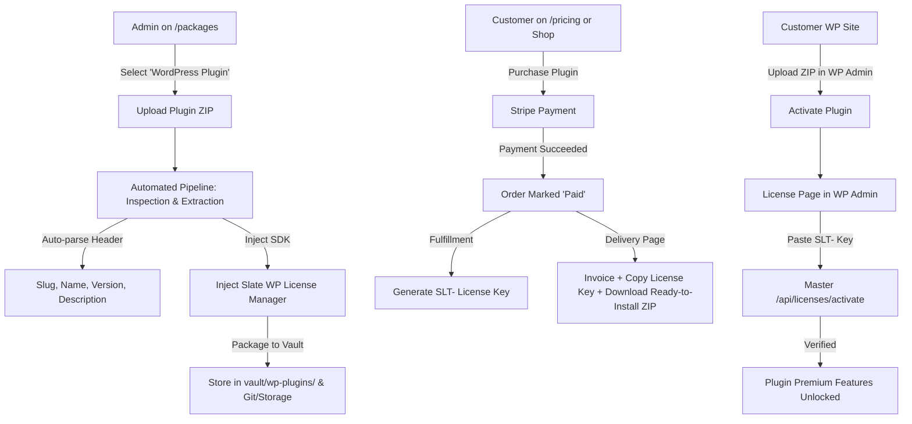

# WordPress Plugin Automated Licensing & Vault Pipeline — Architecture Plan

## Executive Summary
This document outlines the architecture and execution plan to turn the **Slate Master Dashboard** into an automated marketplace and licensing authority for WordPress plugins and digital products, alongside existing Slate custom PHP applications.

---

## 1. User Workflow & Requirements



---

## 2. Core Functional Components

### Component A: Product Type Selector on Master Dashboard (`/packages`)
- **Product Type Dropdown**:
  1. `custom_php`: (Default) Shows existing Slate client platform core plugins list and bundle configuration.
  2. `wordpress_plugin`: Activates the automated ZIP upload dropzone and metadata extractor.
  3. `digital_product`: General downloadable digital assets (software, themes, files) with optional license key issuance.

### Component B: Automated Inspection & Ingestion Pipeline
When the admin uploads a `.zip` file on `/packages`:
1. **ZIP Extraction & Header Parsing**:
   - Scans the extracted files for the main WordPress plugin file containing `/* Plugin Name: ... */`.
   - Extracts:
     - Plugin Name
     - Plugin Slug (folder name or header)
     - Version (e.g. `1.0.0`)
     - Author
     - Short Description / Summary
   - Automatically populates the package form fields on the screen so the admin does not need to type them manually.
2. **Automated License SDK Injection**:
   - Injects `includes/class-slate-wp-license.php` (client REST SDK).
   - Injects `admin/class-slate-wp-license-admin.php` (WP admin settings page with key input, activation button, and status indicators).
   - Injects the bootstrap call into the main plugin file:
     ```php
     // --- SLATE LICENSE SHIELD AUTO-INJECTED ---
     require_once plugin_dir_path(__FILE__) . 'includes/class-slate-wp-license.php';
     Slate_WP_License::init([
         'slug'       => '{PLUGIN_SLUG}',
         'name'       => '{PLUGIN_NAME}',
         'version'    => '{VERSION}',
         'master_url' => '{MASTER_URL}',
     ]);
     ```
3. **Vault Packaging & Storage**:
   - Re-compresses the licensed plugin into a clean, ready-to-install distribution ZIP.
   - Stores it in the dashboard vault (`vault/wp-plugins/{slug}/{version}/...` or S3/persistent storage).
   - Tracks the asset path in the package metadata (`package.assetPath`, `package.productType = "wordpress_plugin"`).

### Component C: Purchase & Fulfillment Pipeline
1. **Customer Checkout**:
   - Customer selects the WordPress plugin on the pricing or checkout page with their desired billing cycle (Monthly, Yearly, Lifetime).
   - Customer completes checkout via Stripe.
2. **Automated Fulfillment**:
   - Webhook or direct payment confirms order (`status: 'paid'`).
   - Master generates:
     - `LicenseRecord` (`product_slug: pluginSlug`, `source: "single"`, `key: "SLT-..."`).
     - A secure, signed, time-limited download URL for the ready-to-install plugin ZIP.
   - Sends email invoice containing:
     - License Key
     - Plugin Download Link
     - Activation instructions

### Component D: Customer Order Delivery Page (`/orders/[id]`)
- For `wordpress_plugin` orders, the order tracking page displays:
  1. **License Key Card**: Masked key with a 1-click "Copy Key" button.
  2. **Download Button**: "Download Plugin ZIP (Ready to Install)" button linking to `/api/orders/[id]/download`.
  3. **3-Step Activation Guide**:
     - Step 1: Upload the downloaded ZIP under WordPress *Plugins > Add New > Upload Plugin*.
     - Step 2: Click *Activate Plugin*.
     - Step 3: Go to the plugin's *License* settings, paste your license key, and click *Activate*.

### Component E: In-WordPress Activation & Remote Control
1. **Activation in WP Admin**:
   - Customer enters license key and clicks "Activate License".
   - Calls `POST /api/licenses/activate` with `{ licenseKey, siteUrl: home_url(), pluginSlug }`.
   - Master validates domain and expiration, and returns `status: "active"` and an encrypted JWT payload.
   - The plugin stores the status in WP options and unlocks premium hooks/features.
2. **Daily Heartbeat & Remote Revocation**:
   - A daily WP Cron checks `GET /api/licenses/check?key=...&site=...`.
   - If an admin clicks **"Revoke"** or **"Suspend"** in the Master Dashboard (`/licenses`), or if subscription cancels in Stripe, the next heartbeat sets `$status = 'revoked'` and locks premium features immediately, without touching or deleting any customer content.

---

## 3. Step-by-Step Implementation Plan

### Phase 1: Package Model & Type Extensibility
- Update `Package` model in `lib/storage.ts` and `lib/models.ts` to support:
  - `productType`: `'custom_php' | 'wordpress_plugin' | 'digital_product'`
  - `assetPath`: string (path to vaulted zip)
  - `version`: string
  - `vaultSha256`: string
- Update `app/packages/page.tsx` UI with the product type selector.

### Phase 2: Ingestion & Vault Upload API
- Create endpoint `POST /api/packages/upload`:
  - Receives uploaded ZIP file.
  - Extracts and parses main WordPress plugin header.
  - Generates the auto-injected licensing SDK into the plugin directory.
  - Re-zips into `vault/wp-plugins/{slug}/...`.
  - Returns extracted metadata: `{ name, slug, version, description, assetPath }` to auto-fill the package creation form.

### Phase 3: The Slate WordPress Licensing SDK Template
- Create template files in `lib/wpSdk/`:
  - `class-slate-wp-license.php`: REST activation, verification, daily cron heartbeat, and activation helper.
  - `class-slate-wp-license-admin.php`: Clean WordPress admin UI with key input, activate/deactivate button, and status banner.

### Phase 4: Secure Download Endpoint
- Create endpoint `GET /api/orders/[id]/download`:
  - Verifies order payment status is `'paid'`.
  - Serves the vaulted distribution ZIP file with proper `Content-Disposition: attachment; filename="{slug}-v{version}.zip"`.

### Phase 5: Order Delivery Page Updates (`app/orders/[id]/page.tsx`)
- When `order.package_type === 'wordpress_plugin'` (or package has an asset):
  - Render the dedicated "Your Download & License" panel.
  - Prominent "Download Plugin ZIP" button and "Copy License Key" card.
  - Step-by-step WordPress installation instructions.

### Phase 6: End-to-End Verification & Automated Test Suite
- Test ZIP parsing and auto-fill of plugin header metadata.
- Test SDK injection and ZIP re-bundling.
- Test order fulfillment, download endpoint permissions, and mock activation from a WordPress environment.
- Run typecheck and full test suite.

---

## 4. Security & Safety Principles
1. **Zero Data Loss**: Expiration or revocation in WordPress never deletes customer database tables or content.
2. **Vault Security**: Direct access to vaulted ZIP files is blocked; downloads must pass through authenticated order verification.
3. **Offline Grace Period**: WordPress plugin includes a 72-hour grace period if the Master server experiences network downtime during a daily heartbeat.
